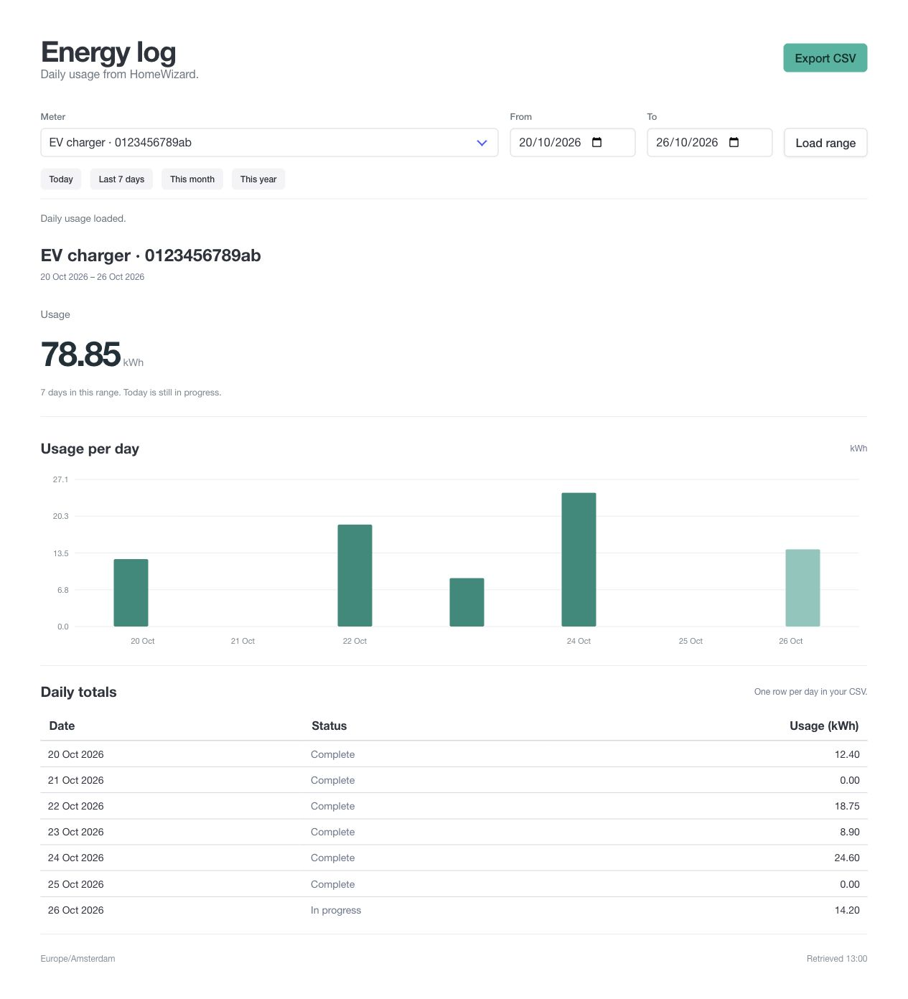

<div align="center">

# HomeWizard Dash

### Your energy history. A clear daily view. A CSV you can use.

A lightweight dashboard for HomeWizard owners, with daily usage, date ranges and simple exports.

[](https://workers.cloudflare.com/)
[](https://bulma.io/)
[](public/app.js)

[Get started](#get-started) · [EV charging & ERE-certificaten](#ev-charging--ere-certificaten) · [Deploy](#deploy-to-cloudflare) · [CSV format](#csv-format)



*Preview uses fictional readings and a demo meter serial.*

</div>

## Why HomeWizard Dash?

HomeWizard already collects your energy history. This project makes it easy to choose a period, inspect daily usage and download the same figures as CSV—without setting up a database, a background collector or a frontend framework.

| Feature | What you get |
| --- | --- |
| **Daily usage** | A total, a bar chart and a daily table in kWh. |
| **Flexible periods** | Any inclusive range up to 366 days, plus Today, Last 7 days, This month and This year. |
| **Traceable exports** | One CSV row per day, including the meter name and serial number. |
| **Either meter direction** | Usage calculated as `Math.abs(import + export)`. |
| **Fast browsing** | Concurrent history requests and caching for recently viewed ranges. |
| **Small deployment** | One Cloudflare Worker, plain HTML/JavaScript and locally bundled Bulma 1. |

## EV charging & ERE-certificaten

Especially useful for HomeWizard owners who need to **document their home EV charging usage for Dutch ERE-certificaten compensation** (*thuislaadvergoeding*).

> I built this to document my own EV charging usage for [Joulo](https://joulo.nl/).
> — [Niek](https://github.com/Niek)

Select your charging meter, choose the reporting period and export the daily kWh figures with the meter's serial number. Keep that export alongside the meter documentation and other evidence requested by your inboekdienstverlener.

For EV charging records, use a meter dedicated to the charging circuit. A whole-house P1 total also includes other electricity use. The dashboard prepares supporting records; your provider determines the required evidence and eligibility. It does not submit ERE registrations or connect directly to Joulo.

This is an independent project, unaffiliated with HomeWizard or Joulo.

## Get started

You need **Node.js 22 or newer**, npm, a HomeWizard account and a meter with cloud history.

```sh
git clone https://github.com/Niek/homewizard-dash.git
cd homewizard-dash
npm ci
cp .env.example .env
```

Edit `.env` with your HomeWizard account credentials:

```dotenv
HOMEWIZARD_EMAIL=you@example.com
HOMEWIZARD_PASSWORD="your-password"
```

Then start the dashboard:

```sh
chmod 600 .env
npm run dev
```

Open **http://127.0.0.1:8787**. Wrangler reads `.env` locally and the Worker handles all HomeWizard requests. Credentials never go to the browser. `.env` is ignored by Git and is outside the public assets directory.

### Supported meters

- **HomeWizard kWh meters** (`energymeter`): verified with a real meter.
- **HomeWizard P1 meters** (`p1dongle`): supported in the API mapping, but not yet verified against a real P1 account.

Available dates depend on the history HomeWizard retains for your account. Nothing needs to be collected locally in advance.

## Deploy to Cloudflare

Sign in to Cloudflare and deploy:

```sh
npx wrangler login
npm run deploy
```

The deployment command uploads the credentials from `.env` as Worker secrets. The Worker is named `homewizard-dash`; change `name` in `wrangler.jsonc` if you want a different name.

> [!IMPORTANT]
> There is **no authentication** on the dashboard or its data endpoints. Anyone with the deployed URL can view and export your meter readings. For private use, keep it local or protect the deployment with Cloudflare Access.

No database, scheduled jobs or Home Assistant installation are required.

## CSV format

The export contains exactly one row per calendar day in the selected period:

```csv
date,meter,serial_number,usage_kwh
2026-10-20,EV charger,0123456789ab,12.4
2026-10-21,EV charger,0123456789ab,0
2026-10-22,EV charger,0123456789ab,18.75
```

- **Dates:** `YYYY-MM-DD`, using `Europe/Amsterdam`.
- **Usage:** kWh, calculated from the daily import and export totals.
- **Missing data:** an empty usage cell, never an invented zero.
- **Today:** a partial total while the day is in progress.
- **Encoding:** UTF-8 with a BOM and CRLF line endings for spreadsheet compatibility.

The CSV is generated from the loaded range, so it matches the displayed daily figures. There are no hourly or five-minute rows.

## How it works

```text
Browser → Cloudflare Worker → HomeWizard cloud
        ← Daily usage JSON  ← History & meter totals
          ↓
        CSV export
```

The Worker signs in to HomeWizard, discovers the account's meters and requests weekly history containing daily totals. Today is refreshed separately because the weekly history can lag behind active charging. Daily energy is taken from HomeWizard's totals, not estimated from power samples.

Usage is `Math.abs(import + export)`. Both counters contribute when both directions have recorded energy; this is not net grid consumption. If either counter is missing, usage remains unknown. The page labels the range sum as a subtotal when some days are unavailable.

Long ranges load in parallel pages of at most 126 days. Each page uses up to six concurrent history requests. This preserves daily detail while keeping each Worker invocation below the Free plan's subrequest limit, including authentication retries.

<details>
<summary><strong>API endpoints & caching</strong></summary>

| Endpoint | Response |
| --- | --- |
| `GET /api/devices` | Meter names, serial numbers, IDs, the current date and timezone. |
| `GET /api/range?from=YYYY-MM-DD&to=YYYY-MM-DD&device=energymeter/...` | Daily usage for an inclusive range. Follow `nextFrom` until it is `null`. |

Dates use Amsterdam calendar boundaries, including daylight-saving changes and ISO week years.

The Worker caches device discovery for five minutes, the current week's history for one minute and older weeks for one hour, with at most 64 cached weeks per instance. Concurrent requests share authentication, discovery and pending history requests.

The browser caches up to 12 recently viewed ranges: one minute when they include today, one hour otherwise. **Load range** bypasses the browser cache and refreshes today's total. All caches are disposable; there is no persistent storage.

</details>

## Development

```sh
npm run check                         # JavaScript syntax
npm test                              # Dates, DST, CSV, caching and concurrency
npx wrangler deploy --dry-run          # Build without publishing
```

| Path | Purpose |
| --- | --- |
| `src/homewizard.js` | Cloud authentication, device discovery and daily usage. |
| `src/worker.js` | Read-only JSON endpoints. |
| `public/` | Dashboard, chart and CSV export. |
| `test/` | Tests with fictional credentials and meter identifiers. |
| `wrangler.jsonc` | Worker configuration and static assets. |

## Acknowledgements

The cloud API is unofficial and may change. Authentication and device discovery were researched from [HomeWizardCloudAPI](https://github.com/jtebbens/com.homewizard/blob/master/lib/homewizard-cloud-api.js); history requests were verified against HomeWizard's web portal and a real kWh meter. This implementation uses native `fetch` and does not import the Node.js WebSocket client.

Built with [Cloudflare Workers](https://workers.cloudflare.com/) and [Bulma](https://bulma.io/).
